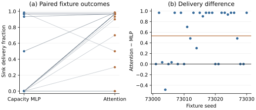

# Matched-capacity closed-loop diagnostic

## Methods and results text for manuscript review

We tested the feedback-to-routing path through actual UDP datagrams using 30 new synthetic network fixtures and the 30 previously trained checkpoints of each architecture. The attention policy contained 63,368 parameters and the MLP contained 63,554. Each fixture used two shared fault targets: the relay initially preferred by attention and the relay initially preferred by the MLP. Both policies faced both targets. Each controller made 30 decisions per target, giving 120 runs and 3,600 packet attempts. A separate sink socket witnessed downstream receipt before the relay acknowledged forwarding. Only risk posteriors evolved within a run; network geometry, energy, queues and QoS state remained fixed.

Mean sink delivery, averaged over both target strata within each fixture, was 85.39% for attention and 32.22% for the matched-capacity MLP. The paired attention-minus-MLP difference was 53.17 percentage points (95% Student-t CI, 35.31–71.02; two-sided paired t-test, p = 1.246 × 10^-6; n = 30 fixtures). The paired delivery figure shows the individual outcomes, including fixtures where attention did not improve delivery. Across both controllers, 2,117 attempts had witnessed sink receipt; 1,483 timed out. There were no acknowledgment/witness mismatches. A separate verifier reconstructed every pre/post observation, accumulated posterior, checkpoint hash, policy probability vector and selected action. All 3,600 records passed verification. The repository test suite also passed all 47 tests.

These results show that the frozen attention routing pipeline can use packet-derived feedback to avoid a persistent forwarding fault, with higher delivery than this MLP comparator under the specified diagnostic. They do not overturn the earlier nominal-simulation finding that attention lacked corrected co-primary superiority. The diagnostic deliberately places a fault on an initially preferred relay, and its two target strata remain correlated; averaging within fixture avoids treating them as independent experiments. No checkpoint, hyperparameter or endpoint was selected after viewing these outcomes.

## Critical vulnerabilities and limitations

The datagrams carry the seven-byte fixture payload plus JSON framing and acknowledgment metadata; they are not the simulator's 4,000-bit application packet. Link PDR and other candidate features are synthetic. Localhost sockets do not reproduce radio interference, MAC contention, distributed monitoring, retransmission energy, sleep currents or channel fading. The sink is trusted, and nonces match packets but do not authenticate senders. A cooperating malicious relay and sink could fabricate success. A missing acknowledgment is a forwarding observation, not an intrusion classification.

The source remains fixed inside each run. There is no offered-load sweep or multihop wireless network evaluation. The 20-ms timeout is a harness parameter and must not be interpreted as physical WSN latency. The confidence interval describes variation across the sampled model/topology fixtures in this targeted software diagnostic; it does not establish deployment generalization. All outcomes, including failures, are retained.

## High-novelty opportunities

The evidence supports a focused next research question: whether delivery-witness uncertainty can be included in routing without confusing missing telemetry with malicious forwarding. A defensible extension would distinguish observed failure, absent feedback and authenticated downstream failure, calibrate their uncertainty on held-out network runs, and charge acknowledgment/monitoring traffic to the energy and delay budgets. That extension remains a proposal; it is not implemented or validated here.

## Reproduction and figure

Run `python scripts/run_udp_matched_comparison.py`, `python scripts/verify_udp_matched_comparison.py`, and `python scripts/analyse_udp_matched_comparison.py`. Compressed raw records and SHA-256 checksums are in `outputs/udp_matched_comparison/`. The verifier and analysis accept the compressed archive directly. The protocol was frozen locally before execution and archived before completion. This is an exploratory follow-up to the earlier periodic and persistent-fault diagnostics, not an untouched confirmatory study.

Figure. Shared-target UDP delivery across paired fixtures. Panel (a) joins each fixture's MLP and attention outcomes; panel (b) plots attention-minus-MLP differences. The horizontal orange line is the paired mean difference. Each fixture averages its two target strata.

This evidence is supplementary development material. The manuscript has not yet been revised to incorporate it, and the JICCE practical-effectiveness objection remains partly open pending deployment-relevant network validation.
