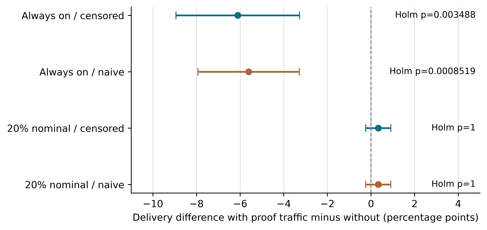

# Post-freeze validation addendum

This addendum reports new implementation and experimental evidence. Its evidence is integrated into Sections 5.6–5.7 of the active 24-page manuscript; the original 22-page manuscript is preserved at commit 6442d2f9caa0ac9ddf1978c3f8ed3b34fdb9b288. Its results are separate from the original 750-run test family and 180-run authenticated transfer study.

## Clock handling

An optional freshness envelope admits sender/receiver timestamp differences under an externally justified bound. A pairwise offset bound of 40 ms and relative drift bound of 100 ppm over 300 s give a 70 ms tolerance. All 675 tested combinations of sender/receiver offsets, drift rates and observation times accepted authentic fresh beacons. Duplicate frames and forged tags remained rejected. Increasing tolerance also extends the stale-acceptance boundary; it does not synchronize clocks or establish true packet age. A device-deployment claim requires measured or otherwise justified clock bounds. The original default freshness behavior remains unchanged.

## Power gating and bounded state

The experimental ns-3.47 bridge integrates radio energy until a sensor's 0.5 J budget is exhausted, removes it from reception and rejects subsequent transmissions. Dedicated zero-budget and mid-traffic tests verify frozen post-cut energy and no post-cut transmission. A first shutdown implementation crashed because live MAC callbacks were invalidated; the corrected implementation retains MAC objects and disables PHY confirmations after power loss. The failed development captures remain separate.

The new ledger clips registration-time reliability once, so split and combined positive evidence carry equal total credit. It retains at most 128 records and a bounded diagnostic history, with a 2 s retention horizon. A 64-identity window permits bounded packet reordering while preventing reused identities from receiving late credit. Identities older than that window are rejected explicitly. For fixed node count, pair state and risk arrays remain quadratic in the number of nodes; this is not a whole-system memory bound.

Twenty-seven 60 s routing diagnostics cross three fixtures, three feedback controls and nominal awake fractions of 1.0, 0.5 and 0.2. Every run remained within the 50 J aggregate sensor budget, and no post-cut transmission was recorded. The bounded ledger had zero final watches in all nine runs; the legacy controls retained records. All sensors exhausted their budgets within 60 s. Modelled total energy is therefore not evidence of sustained operation. Busy transactions defer sleep, so the nominal fractions are scheduling targets rather than measured awake fractions. For the bounded arm, observed awake fractions were approximately 100%, 62% and 41%, respectively.

## Factorial feedback comparison

The amended source and analysis plan were committed as 752c11e before fresh fixtures 89001–89030 were run. An initial proof callback error stopped a preliminary 88001 batch; those partial captures and technical pilot 76901 are excluded. The final study crosses 30 fixtures, two duty settings and four arms, giving 240 runs. Each run offers 60 packets over 4 s. All arms share the bounded positive-credit rule, ACK eligibility, retention horizon, capacity and frozen attention actor. Proof frames are ignored as evidence in every arm. Generating proofs therefore changes traffic while keeping the specified evidence rule fixed within each contrast. Censored versus naive mode changes expiry penalties and late-evidence handling.

Table A1. Factorial arm means.

| Nominal awake fraction | Evidence mode | Proof traffic | Delivery (%) | Critical violations (%) | Radio energy (J) |
|---|---|---|---:|---:|---:|
| 1.0 | Censored | Off | 74.94 | 24.37 | 22.547516 |
| 1.0 | Censored | On | 68.83 | 32.51 | 22.546980 |
| 1.0 | Naive | Off | 75.56 | 24.14 | 22.547497 |
| 1.0 | Naive | On | 69.94 | 30.89 | 22.547013 |
| 0.2 | Censored | Off | 13.50 | 87.84 | 9.791828 |
| 0.2 | Censored | On | 13.83 | 87.71 | 9.749594 |
| 0.2 | Naive | Off | 13.50 | 87.84 | 9.804775 |
| 0.2 | Naive | On | 13.83 | 87.71 | 9.760433 |

With always-on listening, generating proofs reduced censored-mode delivery by 6.11 percentage points (unadjusted paired 95% interval -8.94 to -3.28; Holm-adjusted p=0.00349). The corresponding naive-mode difference was -5.61 points (-7.94 to -3.29; Holm p=0.000852). These contrasts support a traffic contribution under this implementation. They do not retrospectively identify the entire cause of the original 4.67-point result, whose backend and feedback rules differ.

Fig. A1. Proof-traffic effects.

Thirty prespecified extension contrasts form a separate Holm family: proof effects, evidence-mode effects and their interaction across delivery, critical violations and total radio energy. The confidence intervals in Fig. A1 are unadjusted paired t intervals. No evidence-mode or interaction contrast survived the correction. Nonsignificance is not equivalence. The low-duty runs suffered severe delivery loss under the synchronized periodic sleep primitive, which rejects requests while asleep and provides no rendezvous protocol. These results prohibit an unconditional energy-efficiency or deployment claim.

The audit reconciles all 240 summary rows with 60 compressed trace streams and 24,240 radio-energy identities. No record-capacity rejection occurred in these runs. This does not contradict the separate high-pressure stream test, where capacity rejection was deliberately induced.

## Emulated Cortex M3 inference and cryptography

A separate bare-metal C harness executes on QEMU's MPS2 AN385 Cortex-M3 model. It contains all 44,161 FP32 actor parameters, software floating-point inference, HMAC-SHA256 and Monocypher 4.0.3 Ed25519 signing and verification. The harness uses a 512 KiB flash linker limit and a 32 KiB SRAM linker limit. It is not CC2538 radio firmware.

Eight retained radio decisions and eight candidate-permutation controls yield 128 logits. All 16 selected actions match PyTorch and span all eight candidate indices. The maximum absolute logit difference is 1.7881393432617188e-7, below the declared 1e-5 tolerance. The C activation approximation is tested for these vectors, not exhaustively for every possible input.

The HMAC output matches RFC 4231 test case 1. Ed25519 signatures match and verify against the independent Python cryptography implementation; a corrupted signature is rejected. An empty candidate mask yields no action. These algorithm checks do not establish side-channel resistance or integrated wire-protocol correctness.

The linked text and read-only data occupy 341,600 bytes; the ELF container is 407,536 bytes. Stack watermarking observes 3,080 bytes on the tested paths, with zero static writable allocation. This is an isolated harness, excluding radio buffers, RTOS state, packet queues and integrated protocol memory. It establishes that the actor and cryptographic algorithms can execute as Cortex-M3 instructions in emulation; it does not establish a complete 32 KiB embedded routing system.

Only public test keys are compiled into this image. They must never be used for deployment. Vendor source licences and hashes accompany the harness.

## Critical vulnerabilities and limitations

Physical RF, board initialization, measured current, physical timing, whole-firmware memory use and integrated on-MCU authenticated routing remain unvalidated. The QEMU instruction harness and earlier CC2538 UART/radio bridge are distinct experiments and must not be described as one integrated target system. Deadline compliance and queue stability are not established. Coauthor approvals, contribution roles, exclusivity and authenticated journal-portal declarations remain author actions.

## High novelty opportunities

The factorial experiment now separates the effect of proof generation from the declared evidence rule within each contrast. The next deployment study should integrate the tested actor and crypto into the radio firmware, evaluate clock bounds and rendezvous costs, and obtain physical-board traces. New tests should preserve this distinction between algorithm execution, radio integration and field validation.
