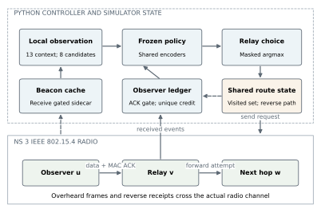
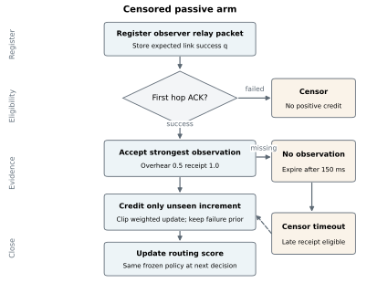
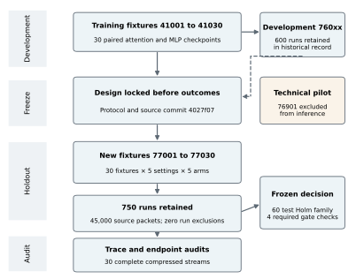
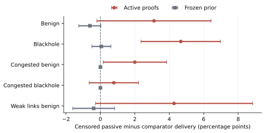
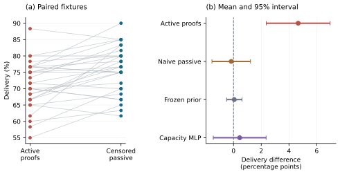
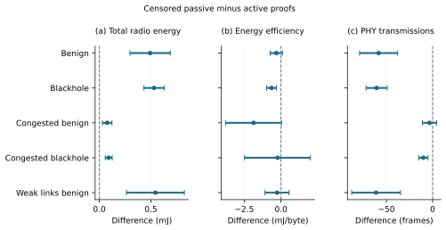

Receipt Assisted Passive Feedback for Multihop Wireless Sensor Routing

Shivam Bhardwaj, Jitendra Nath Srivastava and Akash Sanghi

Faculty of Engineering and Technology, Invertis University, Bareilly, Uttar Pradesh 243123, India

Corresponding author: shibambhardwaj@gmail.com
Coauthors: jitendranathshrivastava@gmail.com; sanghiakash@gmail.com

Running title: Passive Feedback for Sensor Routing

## Abstract

Routing feedback consumes the channel it monitors and can confuse missing observations with forwarding failure. We evaluate receipt assisted passive feedback for a frozen local attention routing policy in an IEEE 802.15.4 simulator. A development study exposed adverse effects of explicit forwarding proofs. The redesigned ledger was then frozen before 750 runs on 30 new fixtures, using naive passive, active proof, frozen prior and capacity matched policy controls. Under blackholes, delivery increased from 71.28% with active proofs to 75.94%, a paired gain of 4.67 percentage points with a 95% confidence interval of 2.36–6.97 and Holm adjusted p=0.0161. All four prespecified incremental gate checks passed. Neither censoring nor attention established superiority over its matched controls. Energy per delivered byte improved, while total modeled radio energy increased slightly. The results support a bounded replacement of the proof based mechanism under the tested assumptions, with open limits in authentication, distributed state, duty cycling and absolute service compliance.

Index Terms: Feedback censoring, Multihop routing, Passive monitoring, Reproducibility, Wireless sensor networks

## I. Introduction

Multihop sensor routing relies on link estimates, path progress and control messages, as illustrated by RPL, expected transmission count and the Collection Tree Protocol [1][2][3]. Adding security evidence creates another dependency: an extra acknowledgment may increase confidence in one hop while occupying airtime needed by another packet. A mechanism should therefore be judged jointly by what it observes and what it sends.

Passive watchdog monitoring and explicit acknowledgment schemes have addressed forwarding misbehavior for decades [4][5]. Overhearing establishes that a relay attempted transmission; it does not establish reception by the intended next hop. Conversely, silence can result from an unsuccessful first link, contention or missed reception. Treating every silence as a malicious action can change routing even in an attack free network. The present study examines that observation ambiguity without introducing an intrusion classifier.

Recent work links trust to edge assisted routing [6], optimizer based next hop selection [7], learned trust estimation [8], failure aware deep Q learning [9] and opportunistic forwarder selection [10]. Trust gated reinforcement learning [11] and secure deep reinforcement learning [12] further demonstrate current interest in the interaction between security and routing. Table 1 maps their stated mechanisms to this study. Their reported performance values are not used as directly comparable baselines because the channels, workloads and attack models differ.

Our initial architecture studies did not establish joint superiority over a capacity matched multilayer perceptron. A subsequent 600-run radio telemetry study also found no corrected architecture advantage and exposed a cost of the active proof mechanism. These negative stages motivated one feedback redesign; they remain available with their raw outputs. The new experiment asks a narrower question: can a receipt assisted passive mechanism replace active proofs without materially degrading a frozen prior control on a new fixture set?

### A. Contribution and research questions

The contribution is an auditable feedback-mechanism comparison: first-hop acknowledgment gates evidence, a record retains the strongest observation rather than every duplicate, and missing observations remain censored. The implementation connects these rules to actual packet reception callbacks. It does not claim to invent watchdog monitoring, censoring, attention or reinforcement learning. Figure 1 separates radio events from simulator-held state, and Fig. 2 shows the event logic.

Three questions organize the evaluation. RQ1 asks whether the replacement improves blackhole delivery relative to active proofs under the frozen multiple-testing rule. RQ2 asks whether it remains within prespecified delivery, critical-service and energy-efficiency margins against frozen-prior attention. RQ3 asks whether the naive passive and capacity matched controls support attribution to censoring or architecture. These questions distinguish a useful replacement from a unique algorithmic advantage.

## II. System model and methods

### A. Radio traffic and threat model

The network contains 100 stationary sensors and one sink at (75, 75) m in a 150 × 150 m field. The ns-3.44 low-rate wireless personal area network model supplies unslotted medium access, acknowledgments and packet-level reception [13]. Log-distance loss uses exponent 3 and reference loss 40 dB; the weak-link condition uses 54 dB. A separate 50 m range limit is retained. This is a radio simulation, not a measurement of an operational sensor deployment.

Each run lasts 4 s and offers 60 source packets after a 0.4 s warm-up. Source intervals are 20 ms, or 2 ms for the congested burst. Traffic classes occur with probabilities 0.35, 0.45 and 0.20 and deadlines of 90, 350 and 1,500 ms. A 64-byte application frame contains 12 identifier bytes and 52 payload bytes; lower-layer overhead is additional. Periodic application-level telemetry broadcasts are termed beacons here; they are not IEEE superframe beacons. They occur every 0.5 s with a 3 ms node offset. Table 2 records the common settings.

In blackhole settings, 25% of sensor identities are selected independently for each fixture. A faulty relay accepts a packet but does not invoke its forwarding decision. It continues to produce the modeled beacon and receipt behavior; forged control values, collusion and compromised sink behavior are outside the threat model. Fault labels control the simulator and evaluation only. The policy receives forwarding observations rather than node attack labels.

### B. State construction and frozen routing policy

A received beacon admits an observer-specific cache entry with energy fraction, pending-request pressure, timestamp and link-quality indication. An entry expires after 0.75 s. Candidate construction excludes the current node, previously visited nodes, exhausted nodes and nodes beyond 50 m. At most eight candidates are retained using the fixed preselection score

Equation 1: S_uv = 1.25 g_uv + 0.75 q_uv + 0.25 e_v - 0.55 R_uv - 0.20 Q_v

• g is sinkward progress divided by 50 m; q is estimated MAC success probability; both are dimensionless.

• e is remaining modeled energy divided by 0.5 J, Q is pending-request pressure normalized by 32, and R is the evidence-risk upper proxy; all are dimensionless.

The complete observation has 13 context values and eight ten-value candidate rows. Context includes local energy and queue state, normalized sink distance, remaining deadline, class indicators and six source-service debts. Each candidate row contains a sink indicator, energy fraction, estimated MAC success, received link quality, queue pressure, sinkward progress, evidence risk and uncertainty, expected retries, and normalized link delay. The training RSSI proxy is replaced by received link-quality indication during radio transfer; this feature shift is retained rather than learned away.

Separate shared encoders transform context x and candidate h into 96-dimensional vectors. Query-to-candidate scoring and a shared bias produce the logit

Equation 2: ell_uv = q_theta(x_u)^T k_theta(h_uv)/sqrt(96) + b_theta(h_uv)

• ℓ is a dimensionless action logit; x and h are the context and candidate feature vectors.

• qθ and kθ are learned query/key transforms and bθ is a learned candidate bias; θ is fixed throughout transfer.

Masked argmax selects the relay. Candidate encoding is shared and the critic uses masked mean pooling, following the set-function motivation in [14]. Attention has 63,368 parameters. The capacity matched perceptron has 63,554 parameters and a 203-unit hidden width. Candidate order is score ranked, and equal scores use the configured identity tie break. Consequently, the implementation supports shared candidate scoring but does not prove invariance of the entire routing pipeline to every node relabeling.

Both checkpoint families were trained on seeds 41001–41030 for 400 episodes per seed using eight updates of 50 episodes and three full-batch PPO epochs per update. Learning rate is 0.0003, clipping 0.2, discount 0.99, generalized-advantage factor 0.95 and entropy coefficient 0.01 [15][16]. Six cost channels penalize class-specific deadline violation and loss. Lagrange multipliers update at rate 0.03 with clipping to [0, 50]. This finite-budget Lagrangian training is not the algorithmic guarantee of constrained policy optimization [17]. No checkpoint or threshold is retuned on the new radio fixtures.

### C. Receipt assisted censored evidence

Each observer u stores a record for selected relay v and packet p. The record contains its expected first-link success, acknowledgment status, expiry, strongest seen evidence and credited strength. A successfully received overheard data frame supplies strength 0.5. A reverse receipt originating from sink delivery supplies strength 1. The maximum rule prevents repeated receptions from accumulating arbitrary strength:

Equation 3: s_uvp <- max(s_uvp, 0.5 I_overheard, I_receipt)

• s is the strongest evidence strength, dimensionless and bounded by 1.

• I_overheard and I_receipt indicate matched received forwarding frames and reverse receipts, respectively; they are dimensionless binary observations.

Credit is eligible only after the observer obtains a successful MAC acknowledgment for its own data request and the new strength exceeds the amount previously credited. An early observation waits for that acknowledgment. The implemented positive update is

Equation 4: alpha_uv <- alpha_uv + clip(q_uv max(0,s_uvp-c_uvp),0.05,1); c_uvp <- s_uvp

• α is a dimensionless effective success count, initialized to 1; c is the credited record strength, initialized to 0.

• q is the dimensionless link-success estimate at registration. The clipping floor applies to each positive increment, not to their sum.

The effective failure count β stays at its prior of 1 in the censored arm. A failed first hop closes the record without positive credit. An acknowledged record with no observed forwarding evidence expires after 150 ms without a failure increment. A late receipt may still upgrade an acknowledged censored record. Near q<0.1, separate half credits interact with the clipping floor and can exceed one full q-weighted increment. The audited decision histories have minimum q=0.6923, so that edge case is outside the observed runs; a calibrated posterior interpretation is nevertheless inappropriate.

The existing risk coordinates are retained as evidence preferences. With the rate-anomaly term inactive, the mean and upper proxy are

Equation 5: rho_uv = 0.75(1-alpha/(alpha+beta)); R_uv = clip(rho_uv + 1.645*0.75*sigma_uv,0,1)

• ρ and R are dimensionless risk coordinates.

• σ is the beta-form standard deviation sqrt[αβ / ((α+β)²(α+β+1))], used as a dimensionless uncertainty proxy rather than a calibrated maliciousness interval.

The naive passive control receives identical observations and deduplicates them, but penalizes missing acknowledged forwarding at expiry. The active control uses separate proof packets and its earlier timeout convention; it can credit a proof without applying the passive first-hop ACK gate. Frozen prior preserves the same initial risk coordinates but disables updates. Capacity matched MLP uses the censored ledger. Table 3 makes these differences explicit. Active versus censored therefore compares complete feedback mechanisms, including semantics and traffic, rather than isolating airtime alone.

### D. Source service state and simulator boundaries

Per-class service debt follows the virtual-queue form motivated by long-run constraint tracking [18]:

Equation 6: Z_c <- max(0,Z_c + I_violation - b_c)

• Zc is a dimensionless source-service debt and bc is the allowed violation fraction for class c.

• I_violation is 1 for a missing or late delivered packet and 0 otherwise; loss has a separate analogous channel.

In this radio transfer, only the source updates those debts after receipt or a 1.5 s expiry. Intermediate nodes do not update a complete service debt for their transit packets. A shared per-packet visited set prevents loops, and a simulator reverse-path map routes receipts. Their state dissemination is not serialized. Beacon energy and queue values likewise use a simulator metadata sidecar keyed to the transmitted identifier; an actual radio receive callback gates availability, but the values are not decoded from wire fields. Figure 1 marks this boundary explicitly. It is a controlled transfer of routing decisions, not an embedded distributed protocol implementation.

Algorithm 1 specifies the tested observer logic. Its event sequence appears in Fig. 2. Physical callback controls check an actual two-hop forwarding observation, silence at an out-of-range observer and zero proof frames in the passive configuration. These checks establish callback behavior; they do not establish authentication or intrusion-detection accuracy.

## III. Experimental design

### A. Development separation and untouched fixtures

Figure 3 accounts for the evidence stages using a PRISMA-inspired staged layout; it is experimental accounting, not a systematic-review selection diagram. The earlier 76001–76030 telemetry fixtures informed the redesign. Protocol, source and the decision rule were published at commit 4027f071322cb5682f39329f656d76df3b68ff62 before evaluation of fixtures 77001–77030. Technical pilot 76901 is excluded from inference. Each new fixture pairs the unchanged attention/MLP checkpoints from 41001 plus its fixture offset.

Five feedback/policy arms cross five settings and 30 fixtures: 750 runs and 45,000 source packets. All runs are retained. Each fixture shares topology, offered packets, traffic classes and blackhole identities across arms. Protocol-induced event schedules can diverge, so identical seeds do not imply identical per-event radio draws. The unit of inference is the complete paired fixture and checkpoint, not individual packets or repeated training of the same network trace. Geometry remains drawn from one stationary placement family with a central sink.

### B. Endpoints and radio accounting

The primary routing summaries count sink reception against all offered source packets. Delivery fraction is

Equation 7: D = N_delivered / 60

• D is dimensionless; Ndelivered counts distinct packet identifiers received by the sink during the 4 s horizon.

For critical class 0, non-delivery counts as a violation, as does delivery beyond 90 ms:

Equation 8: V = sum_{p in C0} I[p missing or delay_p > .09s] / |C0|

• V is a dimensionless violation fraction and C0 is the set of offered critical-class packets.

• delayp is sink reception time minus source generation time, in seconds.

Custom PHY-state integration charges every sensor’s transmit, receive/listen and off intervals, including control traffic and retries. The sink is recorded separately and excluded from the sensor numerator. The assumed 3 V current model gives

Equation 9: E = 3 sum_u(0.0174 T_u,TX + 0.0188 T_u,RXlisten + .000020 T_u,off)

• E is modeled sensor radio energy in joules; residence times T are in seconds and coefficients are amperes.

• The supply is 3 V. Currents are explicit assumptions, not calibrated measurements; CPU, sensing and cryptography are excluded.

Energy efficiency divides this common-horizon expenditure by delivered application payload bytes:

Equation 10: eta = E/(52 N_delivered)

• η is radio joules per delivered payload byte; 52 is payload bytes per packet.

• A lower η can result from a larger delivered-byte denominator even if total E does not decrease.

### C. Statistical analysis and frozen gate

For each endpoint and comparator, the paired difference is computed once per fixture and summarized across 30 fixtures. Two-sided 95% Student t intervals are unadjusted descriptive intervals. The prespecified 60-test Holm family combines five settings, four comparators and three endpoints [19]. Mean delivery and violation differences are reported in percentage points; energy-efficiency differences use J/byte. The family is not reduced after inspection of results.

All four frozen gate checks are required: a positive blackhole delivery difference versus active proofs with Holm p<0.05; a one-sided 95% delivery lower bound above −1 point versus frozen prior; a critical-violation upper bound below +1 point; and an energy-efficiency geometric-ratio upper bound below 1.02. Table 5 reports each check. These margins define an incremental replacement criterion. They do not replace the original absolute class-0 deadline-violation budget of 1.5%.

## IV. Results

### A. Delivery and matched controls

Under blackholes, censored passive attention delivered 75.94% of offered packets, compared with 71.28% for active proofs. The paired difference was +4.67 percentage points, with 95% CI [2.36, 6.97] and Holm p=0.0161. Figure 4 shows setting-level intervals, while Fig. 5 retains every paired fixture and all blackhole comparator contrasts. No other setting’s delivery contrast against active proofs survived the 60-test correction. The effect therefore belongs to the specified blackhole condition rather than to all tested traffic regimes.

Table 4 reports the full blackhole endpoint contrasts. Censored minus naive passive delivery was −0.17 points, and censored minus frozen prior was +0.06 points; neither contrast was significant after correction. The capacity matched MLP contrast was +0.44 points and also inconclusive. These controls rule out a claim that the observed replacement gain establishes a unique benefit from censoring, evidence updating or attention. They do not prove equivalence outside the declared margins.

### B. Energy efficiency and control traffic

Blackhole energy per delivered payload byte decreased by 0.0006443 J/byte relative to active proofs, with 95% CI [−0.0009740, −0.0003145] and Holm p=0.0239. Total sensor radio energy instead rose from 22.546943 to 22.547473 J. This small descriptive increase, 0.000531 J, must not be reported as energy saving. The receive/listen state accounts for a mean 99.36% of modeled sensor radio energy across all 750 runs.

Figure 6 separates the absolute energy numerator, delivered-byte efficiency and PHY transmission count. In blackhole settings, censored passive generated 60.57 fewer PHY transmissions per run on average than active proofs. Every passive/frozen arm requested zero forwarding proofs, while the active arm requested 3,369 across 150 runs. Beacons and existing reverse receipts remain in every arm. Because assumed receive/listen current exceeds transmit current, fewer transmitted frames need not reduce common-horizon joules in this always-listening model. Higher delivery explains the favorable energy-per-byte ratio.

### C. Gate outcome and service limits

The three blackhole frozen-prior margins passed: the one-sided delivery lower bound was −0.405 percentage points, the critical-violation upper bound +0.925 points, and the geometric energy-efficiency ratio upper bound 1.00505. Together with the corrected active-proof delivery contrast, all four gate checks passed (Table 5). The upper critical bound is close to its +1-point margin, so the result should be read at its declared threshold rather than as a large safety reserve.

The critical-violation decrease against active proofs did not survive multiple-testing correction. Absolute critical violations for censored passive remain approximately 26.2% under blackholes, far above the original 1.5% budget. Passing the replacement gate therefore establishes neither absolute deadline compliance nor a guaranteed quality-of-service controller.

### D. Implementation and trace audit

The action/ledger verifier passed 67,522 decisions, 24,747 passive observations, 28,353 evidence updates and 75,750 node-energy identities. An additional endpoint audit reconstructed all 750 final delivery and critical-violation values from source decision times and sink reception events, checked beacon and decision counts, and reconciled PHY-state energy. All 30 gzip streams read successfully to end of stream. The full 51-test suite and the physical callback control passed again during this review.

The trace of fixture 77004 was truncated during release-integrity checking and regenerated under the unchanged frozen implementation. All 750 canonical summary rows matched the pre-recovery summary exactly; no parameter, checkpoint or analysis rule changed. Audit code, provenance and the recovery record are distributed with the raw traces. This internal consistency check is not an independent radio implementation, external capture or a replay of every beacon-receive callback and service-state transition.

## V. Discussion and conclusions

### A. Critical vulnerabilities and limitations

The strongest supported result is a replacement of the tested active proof mechanism. Its comparator changes feedback eligibility and expiry conventions as well as radio traffic, so causation cannot be assigned solely to proof airtime. The naive and frozen-prior controls provide no corrected evidence for a unique censoring effect. The earlier unsuccessful architecture comparisons remain part of the evidence record.

State locality is incomplete. Geometry, packet history and reverse receipt paths are simulator inputs; beacon values use receive-gated metadata. Source-only service debt does not establish transit-aware distributed queue control. Forged receipts, deceptive telemetry, compromised sources, collusion and mobility are untested. Successful passive transmission is evidence of an attempt, not intended-receiver delivery, and the effective-count score is not a live intrusion detector.

The four-second horizon, common central sink and 60-packet burst do not establish steady-state scalability or network lifetime. Candidate scoring is linear in the bounded candidate count after cache sorting, but each expiration poll scans every retained watch. With W records, memory is O(W) and expiration is O(W) per millisecond poll. There is no long-horizon reclamation policy or measured embedded inference cost. Always-listening radio assumptions also exclude the cost of waking specifically to obtain evidence.

The passive strength 0.5, 150 ms expiry, 0.75 s cache life, current model and fixed inference checkpoints were not varied in the new holdout. Their sensitivity remains unknown. Deployment changes to state serialization, acknowledgment authentication, source-service tracking or ledger retirement must be assessed in a separate frozen experiment rather than inserted into this one after observing its outcome.

### B. High novelty opportunities

A stronger next contribution would measure when evidence is worth acquiring. An adaptive observation policy could choose between silence, passive listening and authenticated probes using the expected reduction in delivery loss minus measured radio and processing cost. The discriminating experiment would match feedback semantics and data airtime, introduce duty cycling and adversarial receipts, and reserve new topology and hardware settings. This direction is not implemented in the present study; it follows from the attribution limits exposed here.

### C. Conclusions

Receipt assisted passive feedback passed a prespecified incremental gate on 30 new simulation fixtures. Blackhole delivery improved by 4.67 percentage points over active proofs, and the declared frozen-prior non-inferiority margins held. The matched controls did not establish a unique censoring or attention advantage. Energy efficiency improved through delivered-byte yield while total modeled radio joules increased slightly. The defensible contribution is a reproducible feedback comparison with explicit attribution boundaries; authentication, embedded state exchange and absolute service compliance remain open.

## Acknowledgments

No external funding was received. The authors declare no competing interests. This simulation study involved no human participants, clinical data or animal experiments.

Data and code availability: code, frozen protocol, checkpoints, historical negative outcomes, raw traces and figure sources are available at https://github.com/DrShivamBhardwaj/JICCE_LA_CPPO_Reproducibility. The pre-outcome source freeze is 4027f071322cb5682f39329f656d76df3b68ff62. The complete earlier evidence manuscript is retained in publication/censored_feedback/.

Author contributions: Shivam Bhardwaj, conceptualization, methodology, software, investigation and original draft; Jitendra Nath Srivastava, validation and review; Akash Sanghi, supervision and review. These roles retain the author-provided source statement. Generative AI assisted drafting, code preparation and figure generation; the authors are responsible for verification and final approval.

## References

[1] T. Winter et al., “RPL: IPv6 Routing Protocol for Low-Power and Lossy Networks,” IETF, RFC 6550, 2012. DOI: 10.17487/RFC6550.

[2] D. S. J. De Couto, D. Aguayo, J. Bicket, and R. Morris, “A high-throughput path metric for multi-hop wireless routing,” in Proceedings of MobiCom, pp. 134–146, 2003. DOI: 10.1145/938985.939000.

[3] O. Gnawali, R. Fonseca, K. Jamieson, D. Moss, and P. Levis, “Collection tree protocol,” in Proceedings of SenSys, pp. 1–14, 2009. DOI: 10.1145/1644038.1644040.

[4] S. Marti, T. J. Giuli, K. Lai, and M. Baker, “Mitigating routing misbehavior in mobile ad hoc networks,” in Proceedings of MobiCom, pp. 255–265, 2000. DOI: 10.1145/345910.345955.

[5] K. Liu, J. Deng, P. K. Varshney, and K. Balakrishnan, “An acknowledgment-based approach for the detection of routing misbehavior in MANETs,” IEEE Transactions on Mobile Computing, vol. 6, no. 5, pp. 536–550, 2007. DOI: 10.1109/TMC.2007.1036.

[6] A. Saleh, P. Joshi, R. S. Rathore, and S. S. Sengar, “Trust-aware routing mechanism through an edge node for IoT-enabled sensor networks,” Sensors, vol. 22, no. 20, Art. no. 7820, 2022. DOI: 10.3390/s22207820.

[7] N. Kumar and S. Sharma, “PathGuard: Trustworthy routing for sustainable and secure IoT-WSN networks,” Wireless Personal Communications, vol. 136, pp. 469–487, 2024. DOI: 10.1007/s11277-024-11289-8.

[8] P. Goswami, T. Khan, V. Pathak, and A. Alabdultif, “Machine learning based dynamic trust estimation framework for securing wireless sensor networks,” Scientific Reports, vol. 15, Art. no. 35821, 2025. DOI: 10.1038/s41598-025-19768-z.

[9] S. Tao, H. Tang, J. Wang, and B. Li, “A failure risk-aware multi-hop routing protocol in LPWANs using deep Q-network,” Sensors, vol. 25, no. 14, Art. no. 4416, 2025. DOI: 10.3390/s25144416.

[10] A. A. Lata and M. Kang, “RLFS-OR: Reinforcement learning-based forwarder selection for opportunistic routing in wireless sensor networks,” Electronics, vol. 15, no. 5, Art. no. 910, 2026. DOI: 10.3390/electronics15050910.

[11] R. Zheng, D. Yamkhin, J. Wei, H. Liu, and Z. Khurelbaatar, “Trust-gated reinforcement learning-based secure routing for wireless sensor networks,” Journal of Computational and Cognitive Engineering, online first, 2026. DOI: 10.47852/bonviewJCCE62029141.

[12] R. Gupta, S. K. Gupta, S. B. Singh, R. Kumar, and R. Muthukkumar, “Adaptive deep reinforcement learning–based secure routing for wireless sensor networks,” Scientific Reports, 2026. DOI: 10.1038/s41598-026-62519-x.

[13] ns-3 Project, “IEEE 802.15.4 low-rate wireless personal area network model,” ns-3 Model Library, release 3.44. Available: https://www.nsnam.org/docs/release/3.44/models/ns-3-model-library.pdf. Accessed October 16, 2026.

[14] M. Zaheer et al., “Deep sets,” in Advances in Neural Information Processing Systems, vol. 30, pp. 3391–3401, 2017. Available: https://papers.nips.cc/paper/6931-deep-sets.

[15] J. Schulman, F. Wolski, P. Dhariwal, A. Radford, and O. Klimov, “Proximal policy optimization algorithms,” arXiv:1707.06347, 2017. DOI: 10.48550/arXiv.1707.06347.

[16] J. Schulman, P. Moritz, S. Levine, M. I. Jordan, and P. Abbeel, “High-dimensional continuous control using generalized advantage estimation,” in Proceedings of ICLR, 2016. Available: https://arxiv.org/abs/1506.02438.

[17] J. Achiam, D. Held, A. Tamar, and P. Abbeel, “Constrained policy optimization,” in Proceedings of ICML, vol. 70, pp. 22–31, 2017. Available: https://proceedings.mlr.press/v70/achiam17a.html.

[18] M. J. Neely, Stochastic Network Optimization with Application to Communication and Queueing Systems. Morgan and Claypool, 2010. DOI: 10.2200/S00271ED1V01Y201006CNT007.

[19] S. Holm, “A simple sequentially rejective multiple test procedure,” Scandinavian Journal of Statistics, vol. 6, no. 2, pp. 65–70, 1979. Available: https://www.jstor.org/stable/4615733.

## Algorithm 1 Observer feedback and routing

Input: received MAC events, cached telemetry, fixed policy θ, ledger mode and 150 ms timeout.

Output: next-hop requests and updated observer evidence coordinates.

Steps:

1. At a routing event, reject a visited or exhausted node and enforce the 22-hop cap.

2. Construct receive-gated candidates, retain at most eight and evaluate the masked fixed policy.

3. Register the observer–relay–packet record with expected link success; send the data frame.

4. On own first-hop ACK success, mark the record eligible; credit any stored uncredited observation.

5. On ACK failure, close the passive record without success or failure credit.

6. On a matched received forward attempt, retain maximum strength 0.5.

7. On a matched received reverse delivery receipt, retain maximum strength 1.0.

8. Apply a positive update only if eligible and strength exceeds credited strength; deduplicate repeats.

9. At each 1 ms poll, close expired records; censor missing evidence in the proposed arm.

10. Allow a later receipt to upgrade an acknowledged censored record; keep failure count at its prior.

11. Update source service debt on receipt or service expiry; retain the frozen policy for later decisions.

Table 1. Literature and experimental focus

| Study | Verified mechanism | Relation to this experiment |
|---|---|---|
| Watchdog {{watchdog}} | Overheard forwarding attempts | Established passive observation; reception ambiguity remains |
| 2ACK {{ack}} | Reverse acknowledgment scheme | Explicit feedback adds traffic; no numerical cross-study ranking |
| TARM {{edge}} | Edge assisted trust routing | Trust-aware routing context; different state and deployment |
| PathGuard {{path}} | Trust and optimizer next-hop selection | Publisher abstract verified; not independently replicated |
| SMART {{smart}} | Learned multi-feature trust estimation | Detection task differs from forwarding evidence preference |
| FRDR {{frdr}} and RLFS-OR {{rlfs}} | Failure-aware and opportunistic learning | Different radio and duty-cycle assumptions |
| TG-RL-SR {{tgrl}} and secure DRL {{drlsecure}} | Trust gated and secure routing | Recent context; claims not treated as matched experimental effects |
| This study | ACK gated passive evidence; four controls | Frozen 30-fixture evaluation with retained negative stages |

Table 2. Frozen network settings

| Parameter | Value |
|---|---|
| Sensors and sink | 100 sensors; one central sink |
| Field and range | 150 × 150 m; 50 m hard range |
| Radio engine | ns-3.44; unslotted IEEE 802.15.4 |
| Propagation | Log distance exponent 3; reference loss 40 or 54 dB |
| Run and offered load | 4 s; 60 packets; 0.4 s warm-up |
| Source intervals | 20 ms normal; 2 ms congested |
| Payload and identifiers | 52 and 12 bytes; 64-byte application frame |
| Telemetry broadcast and cache | 0.5 s period; 3 ms/node staggering; 0.75 s expiry |
| Feedback expiry and poll | 150 ms; 1 ms |
| Traffic classes | Probabilities 0.35, 0.45, 0.20; deadlines 90, 350, 1,500 ms |
| Blackhole ratio | 0 or 25%; non-forging forwarding faults |
| Assumed voltage and currents | 3 V; TX 17.4 mA; RX/listen 18.8 mA; off 20 µA |
| Policy parameters | Attention 63,368; MLP 63,554; fixed weights |
| Holdout | 30 fixtures × 5 settings × 5 arms = 750 runs |

Table 3. Feedback controls

| Arm | Evidence and expiry | Policy and interpretation |
|---|---|---|
| Active proofs | Separate proofs; legacy timeout and ACK eligibility | Attention; joint feedback and traffic comparator |
| Naive passive | Overhear/receipt positives; missing ACKed forwarding penalized | Attention; missing-observation control |
| Frozen prior | Same initial risk coordinates; no evidence updates | Attention; score-update control |
| Capacity MLP | Censored ledger with same radio observations | 63554 parameters; representation control |
| Censored passive | Own ACK required; max-strength credit; missing evidence censored | 63368-parameter attention; proposed replacement |

Table 4. Blackhole paired effects

| Comparator | Delivery points | Critical violation points | Energy mJ per byte |
|---|---|---|---|
| Active proofs | +4.667
[+2.365, +6.969]
p=0.01612 | -4.518
[-8.253, -0.783]
p=1 | -0.644
[-0.974, -0.315]
p=0.02385 |
| Naive passive | -0.167
[-1.557, +1.223]
p=1 | -0.017
[-2.381, +2.348]
p=1 | -0.066
[-0.416, +0.284]
p=1 |
| Frozen prior | +0.056
[-0.498, +0.609]
p=1 | -0.124
[-1.388, +1.139]
p=1 | -0.011
[-0.078, +0.057]
p=1 |
| Capacity MLP | +0.444
[-1.461, +2.350]
p=1 | -2.384
[-6.065, +1.298]
p=1 | -0.076
[-0.364, +0.212]
p=1 |

Values are censored passive minus comparator; intervals are unadjusted paired 95% intervals. p values are Holm adjusted over the original 60 tests. Negative critical-violation and energy-per-byte differences favor censored passive. These are differences, not absolute arm means.

Table 5. Prespecified incremental gate

| Check | Frozen criterion | Observed result |
|---|---|---|
| Delivery versus active proofs | Positive gain and Holm p<0.05 | +4.667 points; p=0.0161; pass |
| Delivery versus frozen prior | One-sided lower bound >−1 point | −0.405 points; pass |
| Critical violations versus frozen prior | One-sided upper bound <+1 point | +0.925 points; pass |
| Energy efficiency versus frozen prior | One-sided geometric upper ratio <1.02 | 1.00505; pass |
| Joint incremental decision | All four checks required | Pass; absolute QoS compliance not established |

Fig. 1. Architecture and state boundaries.

Fig. 2. Censored feedback flow.

Fig. 3. Frozen evaluation flow.

Fig. 4. Delivery effects with paired 95% intervals.

Fig. 5. Blackhole fixture outcomes and paired effects.

Fig. 6. Radio effects with paired 95% intervals.

